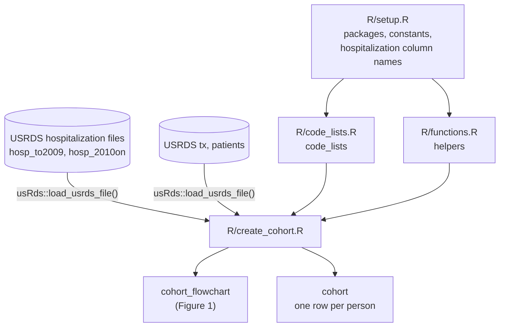

# Architecture

This document describes how the code is organised today. What the analysis is meant to do is in `analysis-plan.md`; how each step maps to usRds is in `references/usrds-coverage.md`.

## Data flow

`R/main.R` sources the scripts in this order: `setup.R` (which sources `code_lists.R`), `functions.R`, `create_cohort.R`. USRDS files are reached only through usRds, located by `usRds::set_USRDS_wd()` on the machine that holds them.

## Scripts

| Script | Role | Needs | Produces |
|---|---|---|---|
| `R/setup.R` | Packages; study constants (window, ages, mortality window, ICD-10 date); the hospitalization files' diagnosis and procedure column names | — | constants; `code_lists` via `code_lists.R` |
| `R/code_lists.R` | Every code list, one row per code, with code type, system, exact or prefix match and source | dplyr, tidyr, stringr | `code_lists` |
| `R/functions.R` | Helpers. Those marked "usRds gap" do work usRds does not yet do | `setup.R` | functions |
| `R/create_cohort.R` | Builds the cohort (plan §4): flags cryptococcosis on hospitalization records, combines records into stays, picks each person's index stay, and applies every exclusion through `flowchart` | `setup.R`, `functions.R`, USRDS files | `cohort_flowchart`, `cohort` |

## Design choices in the code

- **Stays, not records.** All hospitalization records of a person with any cryptococcosis record are combined into stays (`collapse_stays()`) before anything else, so a code on one record of an overlapping stay counts for the whole stay.
- **Exclusions only in the flowchart.** `build_cohort_candidates()` computes flags but drops no one; every exclusion is an `fc_filter()` step, so Figure 1 reproduces the cohort exactly. Box labels are built from the constants in `setup.R`.
- **One person, one row** from the candidates step on. Joins declare their expected relationships, so an unexpected duplicate stops the run.
- **Logic in tested functions, loading in scripts.** The scripts load data through usRds and call functions from `functions.R`; the functions are tested on synthetic data in `tests/test-functions.R`.

## Tests

`tests/test-functions.R` tests every helper on synthetic data with known answers, including boundary dates (window edges, a stay ending on the transplant date, birthdays). Run with `testthat::test_file("tests/test-functions.R")` from the project root. The scripts themselves need usRds and the USRDS files and are not run by the tests.

## Website

One page per script in `quarto/`, importing labelled sections with `knitr::read_chunk()`; the site never runs analysis code. Published by `.github/workflows/publish.yml` to `gh-pages`.
