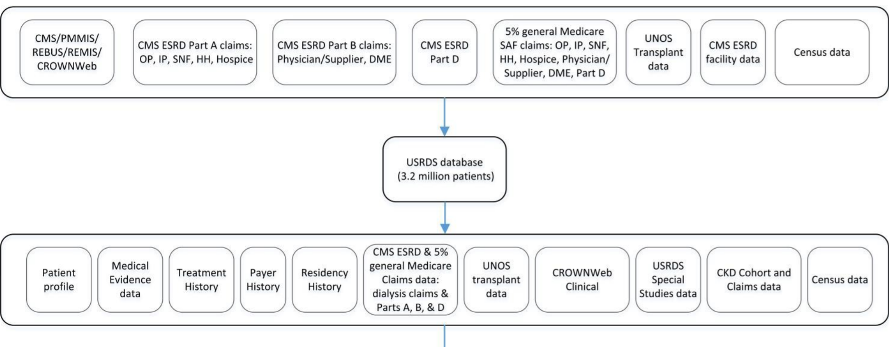

::: {.Results title="Reproduced from the published supplement"}
Everything on this page is reproduced, unchanged, from the Supplementary Data of Fiorica G, Cervera-Hernandez ME, Pirofski L, Hemmige VS, Yoon H. High mortality and associated risk factors in kidney transplant recipients with cryptococcosis: a nationwide cohort study over a decade using USRDS data. *Open Forum Infectious Diseases*. 2025;12(5):ofaf263 [@fiorica2025], © The Author(s) 2025, published by Oxford University Press on behalf of the Infectious Diseases Society of America under a [CC BY-NC-ND 4.0 license](https://creativecommons.org/licenses/by-nc-nd/4.0/). It was **not** produced by this repository's code.
:::

The code lists are transcribed cell for cell from the supplement, with codes as printed: ICD-9 codes with their decimal points in the diagnosis table and without them in the procedure table, and an asterisk marking a code that stands for every code beginning with it. Points to bear in mind when comparing them with this analysis's [code lists](code_lists.qmd) are under [Notes on the supplement](#notes-on-the-supplement).

## Supplementary Figure 1. Data Sources of the USRDS Database and Resultant Data

For more detailed information, refer to the [USRDS Researcher Guide](https://usrds.org/media/2461/usrds_researcher_guide_2020.pdf).

{fig-alt="Diagram of the sources that feed the USRDS database and the data it provides. Sources: CMS/PMMIS/REBUS/REMIS/CROWNWeb; CMS ESRD Part A claims (outpatient, inpatient, skilled nursing facility, home health, hospice); CMS ESRD Part B claims (physician/supplier, durable medical equipment); CMS ESRD Part D; 5% general Medicare SAF claims; UNOS transplant data; CMS ESRD facility data; and census data. These feed the USRDS database (3.2 million patients), which provides patient profile, medical evidence, treatment history, payer history, residency history, CMS ESRD and 5% general Medicare claims (dialysis claims and Parts A, B and D), UNOS transplant data, CROWNWeb clinical data, USRDS special studies, CKD cohort and claims data, and census data." width="100%"}

## Supplementary Table 1. Diagnosis, Billing, and Procedure Codes Used to Extract Data from the USRDS Database

| Diagnosis | ICD code |
|---|---|
| Cryptococcosis | 117.5, 321.0, B45, B45.0, B45.1, B45.2, B45.3, B45.7, B45.8, B45.9 |
| Cryptococcal meningitis | 321.0, B45.1 |
| Transplant complication | 996.81, T86.10, T86.11, T86.12 |
| Acute kidney injury | 584.5, 584.6, 584.7, 584.8, 584.9, N17.0, N17.1, N17.2, N17.8, N17.9 |
| Diabetes | 250\*, E08\*, E09\*, E10\*, E11\*, E13\*, 357.2, 362.02, 362.0, 366.41 |
| Cirrhosis | 456.0, 456.1, 456.2, 456.21, 567.23, 571.2, 571.5, 572.2, 572.3, 572.4, 789.59, K70.3, K70.30, K70.31, K70.4, K70.40, K70.41, K74.6, K74.60, K74.69, I85.0, I85.00, I85.01, I85.1, I85.10, I85.11, I85.9, K72.90, K76.6, K76.7, K65.2 |

| Medication | HCPCS code |
|---|---|
| Cyclosporine | J7502, J7515, J7516 |
| Tacrolimus | J7503, J7507, J7508, J7525 |

| Procedure | ICD code |
|---|---|
| Lumbar puncture | 009U00Z, 009U0ZX, 009U0ZZ, 009U30Z, 009U3ZX, 009U3ZZ, 009U40Z, 009U4ZX, 009U4ZZ, 0331 |
| Spinal procedure | 009W00Z, 009W0ZX, 009W0ZZ, 009W30Z, 009W3ZX, 009W3ZZ, 009W40Z, 009W4ZX, 009W4ZZ, 009X00Z, 009X0ZX, 009X0ZZ, 009X30Z, 009X3ZX, 009X3ZZ, 009X40Z, 009X4ZX, 009X4ZZ, 009Y00Z, 009Y0ZX, 009Y0ZZ, 009Y30Z, 009Y3ZX, 009Y3ZZ, 009Y40Z, 009Y4ZX, 009Y4ZZ, 00BT0ZX, 00BT0ZZ, 00BT3ZX, 00BT3ZZ, 00BT4ZX, 00BT4ZZ, 00BW0ZX, 00BW0ZZ, 00BW3ZX, 00BW3ZZ, 00BW4ZX, 00BW4ZZ, 00BX0ZX, 00BX0ZZ, 00BX3ZX, 00BX3ZZ, 00BX4ZX, 00BX4ZZ, 00BY0ZX, 00BY0ZZ, 00BY3ZX, 00BY3ZZ, 00BY4ZX, 00BY4ZZ, 00JU0ZZ, 00JU3ZZ, 00JU4ZZ, 00JV0ZZ, 00JV3ZZ, 00JV4ZZ, B01B0ZZ, B01B1ZZ, B01BYZZ, B01BZZZ, 0359, 0309, 0395, 0339, 0391, 0390, 0392, 0393, 031, 0321, 0329, 0332, 034, 0351, 0352, 0371, 0379, 0397, 0398, 0399 |
| Neurosurgical procedures | 0016070, 0016071, 0016072, 0016073, 0016074, 0016075, 0016076, 0016077, 0016078, 001607A, 001607B, 00160J0, 00160J1, 00160J2, 00160J3, 00160J4, 00160J5, 00160J6, 00160J7, 00160J8, 00160JA, 00160JB, 00160K0, 00160K1, 00160K2, 00160K3, 00160K4, 00160K5, 00160K6, 00160K7, 00160K8, 00160KA, 00160KB, 00160ZB, 0016370, 0016371, 0016372, 0016373, 0016374, 0016375, 0016376, 0016377, 0016378, 001637A, 001637B, 00163J0, 00163J1, 00163J2, 00163J3, 00163J4, 00163J5, 00163J6, 00163J7, 00163J8, 00163JA, 00163JB, 00163K0, 00163K1, 00163K2, 00163K3, 00163K4, 00163K5, 00163K6, 00163K7, 00163K8, 00163KA, 00163KB, 00163ZB, 0016470, 0016471, 0016472, 0016473, 0016474, 0016475, 0016476, 0016477, 0016478, 001647A, 001647B, 00164J0, 00164J1, 00164J2, 00164J3, 00164J4, 00164J5, 00164J6, 00164J7, 00164J8, 00164JA, 00164JB, 00164K0, 00164K1, 00164K2, 00164K3, 00164K4, 00164K5, 00164K6, 00164K7, 00164K8, 00164KA, 00164KB, 00164ZB, 009000Z, 00900ZX, 00900ZZ, 009030Z, 00903ZX, 00903ZZ, 009040Z, 00904ZX, 00904ZZ, 009100Z, 00910ZX, 00910ZZ, 009130Z, 00913ZX, 00913ZZ, 009140Z, 00914ZX, 00914ZZ, 009200Z, 00920ZX, 00920ZZ, 009230Z, 00923ZX, 00923ZZ, 009240Z, 00924ZX, 00924ZZ, 009300Z, 00930ZX, 00930ZZ, 009330Z, 00933ZX, 00933ZZ, 009340Z, 00934ZX, 00934ZZ, 009400Z, 00940ZX, 00940ZZ, 009430Z, 00943ZX, 00943ZZ, 009440Z, 00944ZX, 00944ZZ, 009500Z, 00950ZX, 00950ZZ, 009530Z, 00953ZX, 00953ZZ, 009540Z, 00954ZX, 00954ZZ, 009600Z, 00960ZX, 00960ZZ, 009630Z, 00963ZX, 00963ZZ, 009640Z, 00964ZX, 00964ZZ, 009700Z, 00970ZX, 00970ZZ, 009730Z, 00973ZX, 00973ZZ, 009740Z, 00974ZX, 00974ZZ, 009800Z, 00980ZX, 00980ZZ, 009830Z, 00983ZX, 00983ZZ, 009840Z, 00984ZX, 00984ZZ, 009900Z, 00990ZX, 00990ZZ, 009930Z, 00993ZX, 00993ZZ, 009940Z, 00994ZX, 00994ZZ, 009A00Z, 009A0ZX, 009A0ZZ, 009A30Z, 009A3ZX, 009A3ZZ, 009A40Z, 009A4ZX, 009A4ZZ, 009B00Z, 009B0ZX, 009B0ZZ, 009B30Z, 009B3ZX, 009B3ZZ, 009B40Z, 009B4ZX, 009B4ZZ, 009C00Z, 009C0ZX, 009C0ZZ, 009C30Z, 009C3ZX, 009C3ZZ, 009C40Z, 009C4ZX, 009C4ZZ, 009D00Z, 009D0ZX, 009D0ZZ, 009D30Z, 009D3ZX, 009D3ZZ, 009D40Z, 009D4ZX, 009D4ZZ, 00J00ZZ, 00J03ZZ, 00J04ZZ, 4A103BD, 4A103KD, 4A103RD, 4A107BD, 4A107KD, 4A107RD, 4A108BD, 4A108KD, 4A108RD, 0101, 0102, 0109, 0110, 0111, 0112, 0113, 0114, 0118, 0121, 0123, 0124, 0125, 0126, 0127, 0128, 0131, 0132, 0139, 0141, 0142, 0151, 0152, 0153, 0159, 0201, 0203, 0204, 0205, 0206, 0207, 0211, 0212, 0213, 022, 0221, 0222, 0231, 0232, 0233, 0234, 0235, 0239, 0241, 0242, 0243, 0291, 0292, 0299 |
| Lung procedures | 07B70ZX, 07B70ZZ, 07B73ZX, 07B73ZZ, 07B74ZX, 07B74ZZ, 0B9300Z, 0B930ZX, 0B930ZZ, 0B9330Z, 0B933ZX, 0B933ZZ, 0B9340Z, 0B934ZX, 0B934ZZ, 0B9370Z, 0B937ZX, 0B937ZZ, 0B9380Z, 0B938ZX, 0B938ZZ, 0B9400Z, 0B940ZX, 0B940ZZ, 0B9430Z, 0B943ZX, 0B943ZZ, 0B9440Z, 0B944ZX, 0B944ZZ, 0B9470Z, 0B947ZX, 0B947ZZ, 0B9480Z, 0B948ZX, 0B9500Z, 0B950ZX, 0B950ZZ, 0B9530Z, 0B953ZX, 0B953ZZ, 0B9540Z, 0B954ZX, 0B954ZZ, 0B9570Z, 0B957ZX, 0B957ZZ, 0B9580Z, 0B958ZX, 0B958ZZ, 0B9600Z, 0B960ZX, 0B960ZZ, 0B9630Z, 0B963ZX, 0B963ZZ, 0B9640Z, 0B964ZX, 0B964ZZ, 0B9670Z, 0B967ZX, 0B967ZZ, 0B9680Z, 0B968ZX, 0B968ZZ, 0B9700Z, 0B970ZX, 0B970ZZ, 0B9730Z, 0B973ZX, 0B973ZZ, 0B9740Z, 0B974ZX, 0B974ZZ, 0B9770Z, 0B977ZX, 0B977ZZ, 0B9780Z, 0B978ZX, 0B978ZZ, 0B9800Z, 0B980ZX, 0B980ZZ, 0B9830Z, 0B983ZX, 0B983ZZ, 0B9840Z, 0B984ZX, 0B984ZZ, 0B9870Z, 0B987ZX, 0B987ZZ, 0B9880Z, 0B988ZX, 0B988ZZ, 0B9900Z, 0B990ZX, 0B990ZZ, 0B9930Z, 0B993ZX, 0B993ZZ, 0B9940Z, 0B994ZX, 0B994ZZ, 0B9970Z, 0B997ZX, 0B997ZZ, 0B9980Z, 0B998ZX, 0B9B00Z, 0B9B0ZX, 0B9B0ZZ, 0B9B30Z, 0B9B3ZX, 0B9B3ZZ, 0B9B40Z, 0B9B4ZX, 0B9B4ZZ, 0B9B70Z, 0B9B7ZX, 0B9B7ZZ, 0B9B80Z, 0B9B8ZX, 0B9B8ZZ, 0B9C00Z, 0B9C0ZX, 0B9C0ZZ, 0B9C30Z, 0B9C3ZX, 0B9C3ZZ, 0B9C40Z, 0B9C4ZX, 0B9C4ZZ, 0B9C70Z, 0B9C7ZX, 0B9C7ZZ, 0B9C80Z, 0B9C8ZX, 0B9C8ZZ, 0B9D00Z, 0B9D0ZX, 0B9D0ZZ, 0B9D30Z, 0B9D3ZX, 0B9D3ZZ, 0B9D40Z, 0B9D4ZX, 0B9D4ZZ, 0B9D70Z, 0B9D7ZX, 0B9D7ZZ, 0B9D80Z, 0B9D8ZX, 0B9D8ZZ, 0B9F00Z, 0B9F0ZX, 0B9F0ZZ, 0B9F30Z, 0B9F3ZX, 0B9F3ZZ, 0B9F40Z, 0B9F4ZX, 0B9F4ZZ, 0B9F70Z, 0B9F7ZX, 0B9F7ZZ, 0B9F80Z, 0B9F8ZX, 0B9F8ZZ, 0B9G00Z, 0B9G0ZX, 0B9G0ZZ, 0B9G30Z, 0B9G3ZX, 0B9G3ZZ, 0B9G40Z, 0B9G4ZX, 0B9G4ZZ, 0B9G70Z, 0B9G7ZX, 0B9G7ZZ, 0B9G80Z, 0B9G8ZX, 0B9G8ZZ, 0B9H00Z, 0B9H0ZX, 0B9H0ZZ, 0B9H30Z, 0B9H3ZX, 0B9H3ZZ, 0B9H40Z, 0B9H4ZX, 0B9H4ZZ, 0B9H70Z, 0B9H7ZX, 0B9H7ZZ, 0B9H80Z, 0B9H8ZX, 0B9H8ZZ, 0B9J00Z, 0B9J0ZX, 0B9J0ZZ, 0B9J30Z, 0B9J3ZX, 0B9J3ZZ, 0B9J40Z, 0B9J4ZX, 0B9J4ZZ, 0B9J70Z, 0B9J7ZX, 0B9J7ZZ, 0B9J80Z, 0B9J8ZX, 0B9J8ZZ, 0B9K00Z, 0B9K0ZX, 0B9K0ZZ, 0B9K30Z, 0B9K3ZX, 0B9K3ZZ, 0B9K40Z, 0B9K4ZX, 0B9K4ZZ, 0B9K70Z, 0B9K7ZX, 0B9K7ZZ, 0B9K80Z, 0B9K8ZX, 0B9K8ZZ, 0B9L00Z, 0B9L0ZX, 0B9L0ZZ, 0B9L30Z, 0B9L3ZX, 0B9L3ZZ, 0B9L40Z, 0B9L4ZX, 0B9L4ZZ, 0B9L70Z, 0B9L7ZX, 0B9L7ZZ, 0B9L80Z, 0B9L8ZX, 0B9L8ZZ, 0B9M00Z, 0B9M0ZX, 0B9M0ZZ, 0B9M30Z, 0B9M3ZX, 0B9M3ZZ, 0B9M40Z, 0B9M4ZX, 0B9M4ZZ, 0B9M70Z, 0B9M7ZX, 0B9M7ZZ, 0B9M80Z, 0B9M8ZX, 0B9M8ZZ, 0B9N00Z, 0B9N0ZX, 0B9N0ZZ, 0B9N30Z, 0B9N3ZX, 0B9N3ZZ, 0B9N40Z, 0B9N4ZX, 0B9N4ZZ, 0B9N80Z, 0B9N8ZX, 0B9N8ZZ, 0B9P00Z, 0B9P0ZX, 0B9P0ZZ, 0B9P30Z, 0B9P3ZX, 0B9P3ZZ, 0B9P40Z, 0B9P4ZX, 0B9P4ZZ, 0B9P80Z, 0B9P8ZX, 0B9P8ZZ, 0BB30ZX, 0BB30ZZ, 0BB33ZX, 0BB33ZZ, 0BB34ZX, 0BB34ZZ, 0BB37ZX, 0BB37ZZ, 0BB38ZX, 0BB38ZZ, 0BB40ZX, 0BB40ZZ, 0BB43ZX, 0BB43ZZ, 0BB44ZX, 0BB44ZZ, 0BB47ZX, 0BB47ZZ, 0BB48ZX, 0BB48ZZ, 0BB50ZX, 0BB50ZZ, 0BB53ZX, 0BB53ZZ, 0BB54ZX, 0BB54ZZ, 0BB57ZX, 0BB57ZZ, 0BB58ZX, 0BB58ZZ, 0BB60ZX, 0BB60ZZ, 0BB63ZX, 0BB63ZZ, 0BB64ZX, 0BB64ZZ, 0BB67ZX, 0BB67ZZ, 0BB68ZX, 0BB68ZZ, 0BB70ZX, 0BB70ZZ, 0BB73ZX, 0BB73ZZ, 0BB74ZX, 0BB74ZZ, 0BB77ZX, 0BB77ZZ, 0BB78ZX, 0BB78ZZ, 0BB80ZX, 0BB80ZZ, 0BB83ZX, 0BB83ZZ, 0BB84ZX, 0BB84ZZ, 0BB87ZX, 0BB87ZZ, 0BB88ZX, 0BB88ZZ, 0BB90ZX, 0BB90ZZ, 0BB93ZX, 0BB93ZZ, 0BB94ZX, 0BB94ZZ, 0BB97ZX, 0BB97ZZ, 0BB98ZX, 0BB98ZZ, 0BBB0ZX, 0BBB0ZZ, 0BBB3ZX, 0BBB3ZZ, 0BBB4ZX, 0BBB4ZZ, 0BBB7ZX, 0BBB7ZZ, 0BBB8ZX, 0BBB8ZZ, 0BBC0ZX, 0BBC0ZZ, 0BBC3ZX, 0BBC3ZZ, 0BBC4ZX, 0BBC4ZZ, 0BBC7ZX, 0BBC7ZZ, 0BBC8ZX, 0BBC8ZZ, 0BBD0ZX, 0BBD0ZZ, 0BBD3ZX, 0BBD3ZZ, 0BBD4ZX, 0BBD4ZZ, 0BBD7ZX, 0BBD7ZZ, 0BBD8ZX, 0BBD8ZZ, 0BBF0ZX, 0BBF0ZZ, 0BBF3ZX, 0BBF3ZZ, 0BBF4ZX, 0BBF4ZZ, 0BBF7ZX, 0BBF7ZZ, 0BBF8ZX, 0BBF8ZZ, 0BBG0ZX, 0BBG0ZZ, 0BBG3ZX, 0BBG3ZZ, 0BBG4ZX, 0BBG4ZZ, 0BBG7ZX, 0BBG7ZZ, 0BBG8ZX, 0BBG8ZZ, 0BBH0ZX, 0BBH0ZZ, 0BBH3ZX, 0BBH3ZZ, 0BBH4ZX, 0BBH4ZZ, 0BBH7ZX, 0BBH7ZZ, 0BBH8ZX, 0BBH8ZZ, 0BBJ0ZX, 0BBJ0ZZ, 0BBJ3ZX, 0BBJ3ZZ, 0BBJ4ZX, 0BBJ4ZZ, 0BBJ7ZX, 0BBJ7ZZ, 0BBJ8ZX, 0BBJ8ZZ, 0BBK0ZX, 0BBK0ZZ, 0BBK3ZX, 0BBK3ZZ, 0BBK4ZX, 0BBK4ZZ, 0BBK7ZX, 0BBK7ZZ, 0BBK8ZX, 0BBK8ZZ, 0BBL0ZX, 0BBL0ZZ, 0BBL3ZX, 0BBL3ZZ, 0BBL4ZX, 0BBL4ZZ, 0BBL7ZX, 0BBL7ZZ, 0BBL8ZX, 0BBL8ZZ, 0BBM0ZX, 0BBM0ZZ, 0BBM3ZX, 0BBM3ZZ, 0BBM4ZX, 0BBM4ZZ, 0BBM7ZX, 0BBM7ZZ, 0BBM8ZX, 0BBM8ZZ, 0BBN0ZX, 0BBN0ZZ, 0BBN3ZX, 0BBN3ZZ, 0BBN4ZX, 0BBN4ZZ, 0BBN8ZX, 0BBN8ZZ, 0BBP0ZX, 0BBP0ZZ, 0BBP3ZX, 0BBP3ZZ, 0BBP4ZX, 0BBP4ZZ, 0BBP8ZX, 0BBP8ZZ, 0BC30ZZ, 0BC33ZZ, 0BC34ZZ, 0BC37ZZ, 0BC38ZZ, 0BC40ZZ, 0BC43ZZ, 0BC44ZZ, 0BC47ZZ, 0BC48ZZ, 0BC50ZZ, 0BC53ZZ, 0BC54ZZ, 0BC57ZZ, 0BC58ZZ, 0BC60ZZ, 0BC63ZZ, 0BC64ZZ, 0BC67ZZ, 0BC68ZZ, 0BC70ZZ, 0BC73ZZ, 0BC74ZZ, 0BC77ZZ, 0BC78ZZ, 0BC80ZZ, 0BC83ZZ, 0BC84ZZ, 0BC87ZZ, 0BC88ZZ, 0BC90ZZ, 0BC93ZZ, 0BC94ZZ, 0BC97ZZ, 0BC98ZZ, 0BCB0ZZ, 0BCB3ZZ, 0BCB4ZZ, 0BCB7ZZ, 0BCB8ZZ, 0BCC0ZZ, 0BCC3ZZ, 0BCC4ZZ, 0BCC7ZZ, 0BCC8ZZ, 0BCD0ZZ, 0BCD3ZZ, 0BCD4ZZ, 0BCD7ZZ, 0BCD8ZZ, 0BCF0ZZ, 0BCF3ZZ, 0BCF4ZZ, 0BCF7ZZ, 0BCF8ZZ, 0BCG0ZZ, 0BCG3ZZ, 0BCG4ZZ, 0BCG7ZZ, 0BCG8ZZ, 0BCH0ZZ, 0BCH3ZZ, 0BCH4ZZ, 0BCH7ZZ, 0BCH8ZZ, 0BCJ0ZZ, 0BCJ3ZZ, 0BCJ4ZZ, 0BCJ7ZZ, 0BCJ8ZZ, 0BCK0ZZ, 0BCK3ZZ, 0BCK4ZZ, 0BCK7ZZ, 0BCK8ZZ, 0BCL0ZZ, 0BCL3ZZ, 0BCL4ZZ, 0BCL7ZZ, 0BCL8ZZ, 0BCM0ZZ, 0BCM3ZZ, 0BCM4ZZ, 0BCM7ZZ, 0BCM8ZZ, 0BCN0ZZ, 0BCN3ZZ, 0BCN4ZZ, 0BCP0ZZ, 0BCP3ZZ, 0BCP4ZZ, 0BD34ZX, 0BD38ZX, 0BD44ZX, 0BD48ZX, 0BD54ZX, 0BD58ZX, 0BD64ZX, 0BD68ZX, 0BD74ZX, 0BD78ZX, 0BD84ZX, 0BD88ZX, 0BD94ZX, 0BD98ZX, 0BDB4ZX, 0BDB8ZX, 0BDC4ZX, 0BDC8ZX, 0BDD4ZX, 0BDD8ZX, 0BDF4ZX, 0BDF8ZX, 0BDG4ZX, 0BDG8ZX, 0BDH4ZX, 0BDH8ZX, 0BDJ4ZX, 0BDJ8ZX, 0BDK4ZX, 0BDK8ZX, 0BDL4ZX, 0BDL8ZX, 0BDM4ZX, 0BDM8ZX, 0BDN0ZX, 0BDN0ZZ, 0BDN3ZX, 0BDN3ZZ, 0BDN4ZX, 0BDN4ZZ, 0BDP0ZX, 0BDP0ZZ, 0BDP3ZX, 0BDP3ZZ, 0BDP4ZX, 0BDP4ZZ, 0BJ00ZZ, 0BJ03ZZ, 0BJ04ZZ, 0BJ07ZZ, 0BJ08ZZ, 0BJ0XZZ, 0BJ10ZZ, 0BJ13ZZ, 0BJ14ZZ, 0BJ17ZZ, 0BJ18ZZ, 0BJ1XZZ, 0BJK0ZZ, 0BJK3ZZ, 0BJK4ZZ, 0BJK7ZZ, 0BJK8ZZ, 0BJKXZZ, 0BJL0ZZ, 0BJL3ZZ, 0BJL4ZZ, 0BJL7ZZ, 0BJL8ZZ, 0BJLXZZ, 0BJQ0ZZ, 0BJQ3ZZ, 0BJQ4ZZ, 0BJQ7ZZ, 0BJQ8ZZ, 0BJQXZZ, 0BN30ZZ, 0BN33ZZ, 0BN34ZZ, 0BN37ZZ, 0BN38ZZ, 0BN40ZZ, 0BN43ZZ, 0BN44ZZ, 0BN47ZZ, 0BN48ZZ, 0BN50ZZ, 0BN53ZZ, 0BN54ZZ, 0BN57ZZ, 0BN58ZZ, 0BN60ZZ, 0BN63ZZ, 0BN64ZZ, 0BN67ZZ, 0BN68ZZ, 0BN70ZZ, 0BN73ZZ, 0BN74ZZ, 0BN77ZZ, 0BN78ZZ, 0BN80ZZ, 0BN83ZZ, 0BN84ZZ, 0BN87ZZ, 0BN88ZZ, 0BN90ZZ, 0BN93ZZ, 0BN94ZZ, 0BN97ZZ, 0BN98ZZ, 0BNB0ZZ, 0BNB3ZZ, 0BNB4ZZ, 0BNB7ZZ, 0BNB8ZZ, 0BNC0ZZ, 0BNC3ZZ, 0BNC4ZZ, 0BNC7ZZ, 0BNC8ZZ, 0BND0ZZ, 0BND3ZZ, 0BND4ZZ, 0BND7ZZ, 0BND8ZZ, 0BNF0ZZ, 0BNF3ZZ, 0BNF4ZZ, 0BNF7ZZ, 0BNF8ZZ, 0BNG0ZZ, 0BNG3ZZ, 0BNG4ZZ, 0BNG7ZZ, 0BNG8ZZ, 0BNH0ZZ, 0BNH3ZZ, 0BNH4ZZ, 0BNH7ZZ, 0BNH8ZZ, 0BNJ0ZZ, 0BNJ3ZZ, 0BNJ4ZZ, 0BNJ7ZZ, 0BNJ8ZZ, 0BNK0ZZ, 0BNK3ZZ, 0BNK4ZZ, 0BNK7ZZ, 0BNK8ZZ, 0BNL0ZZ, 0BNL3ZZ, 0BNL4ZZ, 0BNL7ZZ, 0BNL8ZZ, 0BNM0ZZ, 0BNM3ZZ, 0BNM4ZZ, 0BNM7ZZ, 0BNM8ZZ, 0BNN0ZZ, 0BNN3ZZ, 0BNN4ZZ, 0BNP0ZZ, 0BNP3ZZ, 0BNP4ZZ, 0BT30ZZ, 0BT34ZZ, 0BT40ZZ, 0BT44ZZ, 0BT50ZZ, 0BT54ZZ, 0BT60ZZ, 0BT64ZZ, 0BT70ZZ, 0BT74ZZ, 0BT80ZZ, 0BT84ZZ, 0BT90ZZ, 0BT94ZZ, 0BTB0ZZ, 0BTB4ZZ, 0BTC0ZZ, 0BTC4ZZ, 0BTD0ZZ, 0BTD4ZZ, 0BTF0ZZ, 0BTF4ZZ, 0BTG0ZZ, 0BTG4ZZ, 0BTH0ZZ, 0BTH4ZZ, 0BTJ0ZZ, 0BTJ4ZZ, 0BTK0ZZ, 0BTK4ZZ, 0BTL0ZZ, 0BTL4ZZ, 0BTM0ZZ, 0BTM4ZZ, 0W9900Z, 0W990ZX, 0W990ZZ, 0W9930Z, 0W993ZX, 0W993ZZ, 0W9940Z, 0W994ZX, 0W994ZZ, 0W9B00Z, 0W9B0ZX, 0W9B0ZZ, 0W9B30Z, 0W9B3ZX, 0W9B3ZZ, 0W9B40Z, 0W9B4ZX, 0W9B4ZZ, 0W9C00Z, 0W9C0ZX, 0W9C0ZZ, 0W9C30Z, 0W9C3ZX, 0W9C3ZZ, 0W9C40Z, 0W9C4ZX, 0W9C4ZZ, 0WBC0ZX, 0WBC0ZZ, 0WBC3ZX, 0WBC3ZZ, 0WBC4ZX, 0WBC4ZZ, 1745, 3201, 3209, 321, 3220, 3228, 3229, 3230, 3239, 3241, 3249, 3250, 3259, 326, 329, 3320, 3321, 3322, 3323, 3324, 3325, 3326, 3327, 3328, 3329, 3339, 3402, 3404, 3406, 3409, 3420, 3421, 3422, 3424, 3451, 3452, 3459, 3491, 3492, 3493, 3499, 9656 |

## Notes on the supplement

These are kept above as printed and listed so this analysis's code lists can be compared with them. How each was handled is on the [Code lists](code_lists.qmd) page and in the linked issues.

-   **Cryptococcosis** lists the ICD-10-CM category B45 itself as well as its subcodes. ICD-10-CM has no codes B45.4 to B45.6, so the subcodes listed are all of them.
-   **Diabetes** marks 250, E08, E09, E10, E11 and E13 with an asterisk, meaning every code beginning with them; the other codes are matched exactly ([#8](https://github.com/VagishHemmige/Fiorica-cryptoccoccus-analysis/issues/8)).
-   **Procedures** are ICD procedure codes only. The paper's Methods mention CPT codes, which the supplement does not list ([#5](https://github.com/VagishHemmige/Fiorica-cryptoccoccus-analysis/issues/5)). There is no separate row for the ventriculoperitoneal shunts the paper reports; the shunt codes are among the neurosurgical procedures ([#8](https://github.com/VagishHemmige/Fiorica-cryptoccoccus-analysis/issues/8)).
-   **Medications** are listed as HCPCS billing codes for cyclosporine and tacrolimus, although the paper's Table 2 reports drug use from the UNOS registration and follow-up records, which is what this analysis uses ([#2](https://github.com/VagishHemmige/Fiorica-cryptoccoccus-analysis/issues/2)).
-   Some ICD-9 procedure codes are three-digit categories (for example 031, 034, 022, 321, 326 and 329), which stand for the codes beneath them.

## References

::: {#refs}
:::
